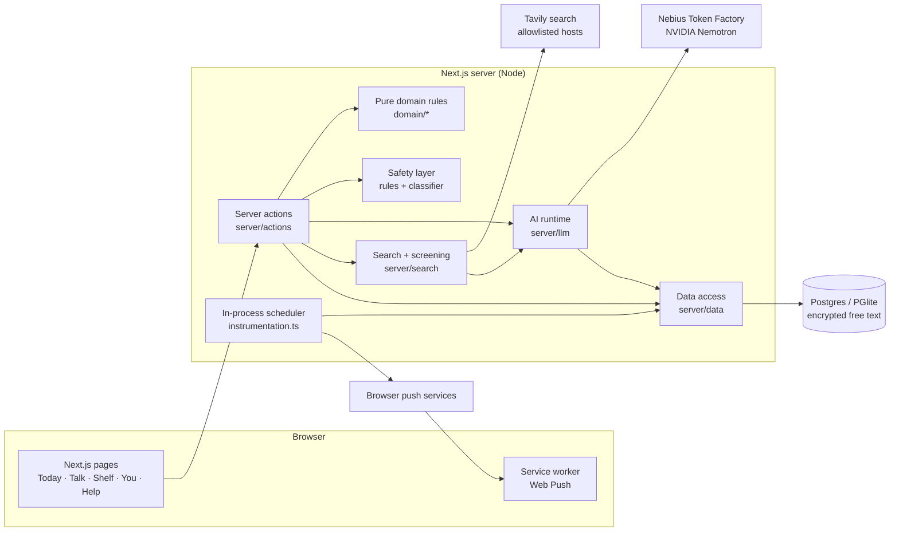

# Koe architecture

Koe is a private AI companion for adults living with depression. It learns about you in a short intake, plans a gentle day, adapts that day when your energy drops, reminds you at the right moments, finds a few trustworthy things to read, and is there to talk. It supports human care and never replaces it.

This document describes the system as built. Items marked **(in progress)** are being built for the current release; their contracts are fixed and their code is not finished yet.

## 1. Principles

1. **The code decides; the model proposes and phrases.** State, scheduling, permissions, counts, safety rules and reminder firing are deterministic code. Models draft plans, write short lines, classify risk and choose tools.
2. **Every model output is validated, and there is a fallback.** Replies are checked against a zod schema, then against the plan rules, the guardrails and the safety rules. Anything that fails is replaced by a deterministic version. With `KOE_AI=off` the whole app still works.
3. **The person stays in control.** A model-made change to the plan, to memory or to reminders is a proposal until the person confirms it, or it comes with a one-tap undo when they asked for the change themselves (for example the daily check-in).
4. **A context packet, not chat history.** Each AI call gets a compact, structured description of the person: the intake model, the approved summary, approved memory cards, outcome counts for the last 7 days and today's plan. The prefix is stable, so the provider can cache it.
5. **Private by default.** Free text is encrypted at rest. Nothing a person writes is ever sent to web search. Memory can be turned off, and the person can export or delete everything.

## 2. System overview

**Stack:** Next.js 16 (App Router, server actions), React 19, TypeScript, zod 4, Drizzle ORM. The database is PGlite (embedded Postgres) locally and Postgres when hosted. Auth is Better Auth with anonymous guests. Web Push uses VAPID. Tests are Vitest (unit and live evals) and Playwright (end-to-end, axe accessibility).

## 3. Code layout (`web/`)

| Path | What lives there |
|---|---|
| `app/` | Routes. `(app)/` holds the signed-in or guest pages: `today`, `talk`, `shelf`, `you/*`, `intake`. Public pages are `/`, `/help`, `/about`, `/privacy` and `/sign-in`. API routes cover auth and export. |
| `features/*` | Client components per feature: intake, today, talk, safety, onboarding, settings, connect, journey. |
| `domain/*` | Pure, unit-tested rules with no I/O: the day-plan menu and guardrails (`plan-menu.ts`), the intake model (`intake.ts`), risk patterns (`safety.ts`), reminder timing (`reminders.ts`), tone lines (`tone.ts`) and time helpers. |
| `server/actions/*` | Server actions, the only write path from the UI. Each checks the viewer, validates input, screens free text and then calls `server/data`. |
| `server/data/*` | Database reads and writes per area. Text is sealed and opened here. |
| `server/llm/*` | The AI runtime (`nebius.ts`), usage logging and budget (`usage.ts`), the context packet (`context.ts`) and one module per agent (`intake.ts`, `talk.ts`, `coach.ts`, planner). |
| `server/search/*` | The Tavily client and, in progress, result screening. |
| `server/db/*` | Schema, migrations runner, guest→account ownership transfer. |
| `drizzle/` | SQL migrations. |
| `instrumentation.ts` | Starts the minute scheduler for reminders and the hourly chat-history purge. |
| `tests/` | Unit tests, `e2e/` (Playwright) and `eval/` (live model evals). |

## 4. Data model

All user-owned tables reference `user` with `ON DELETE CASCADE`. Guest data moves to the account when a guest signs up (`server/db/ownership.ts`). `/api/export` returns everything as JSON. Columns ending in `Enc` hold AES-256-GCM sealed text (`server/crypto.ts`, format `v1.<iv>.<tag>.<ciphertext>`).

| Table | Purpose |
|---|---|
| `user`, `session`, `account`, `verification` | Better Auth. Guests are real anonymous users. |
| `profile` | Region, timezone, 18+ attestation, coaching pause, memory and chat-history switches, reminder budget and quiet hours, tone, appearance. |
| `user_model` | The sealed intake model (goals, routine, what used to help, people, support, tone, morning-plan time) and the summary the person approved. |
| `plan_day` | One row per plan version per local day: energy, mode (normal/lighter) and a sealed snapshot of the items. Used for "what changed" and undo. |
| `step` | An entry in the day (internal name). Kind from the menu, time of day, sealed title and why line, size (tiny/small/medium), origin (intro/planner/you/talk), status. |
| `step_version`, `step_report` | Earlier wordings, and what happened (done/partly/not today, how it compared with expectations). |
| `check_in` | The once-a-day energy answer. |
| `memory_card` | Sentences the person added or approved, with where each came from (intro/you/talk/report). |
| `conversation`, `message` | Talk. Message text and tool proposals are sealed. A conversation can be safety-paused. |
| `person`, `reach_out` | People in your corner, and drafts the person sent themselves. |
| `note`, `weekly_review` | The person's notes and weekly look-back. |
| `reminder`, `push_subscription` | Reminders the person turned on, and browser push endpoints (allowlisted push services only). |
| `safety_event` | That a risk signal was seen, where, and what Koe showed. Never the text. |
| `agent_run` | One row per model or search call: purpose, model, tokens, latency, estimated cost, fallback used, dropped tool calls. Never the text. |
| `shelf_item`, `resource_cache` | **(in progress)** The person's picks (URL, title, sealed why line, Save / Not for me), plus a shared weekly cache per tag set. The cache holds public data only. |

## 5. AI system

### Models (Nebius Token Factory, reasoning off via `chat_template_kwargs.enable_thinking=false`)

| Role | Default model | Why |
|---|---|---|
| Intake synthesis, day planning, Talk | `nvidia/Nemotron-3-Ultra-550b-a55b` | The best judgement for personal plans and conversation; fast with reasoning off. |
| Safety classifier, small rewrites, resource screening | `nvidia/NVIDIA-Nemotron-3-Nano-30B-A3B` | Cheap and quick for narrow yes/no and one-line jobs. |
| Fallback | `nvidia/nemotron-3-super-120b-a12b` | Used once when the primary fails with a network error, timeout, 5xx or 429. It shares the caller's time budget. |

Model IDs are configuration (`KOE_CHAT_MODEL`, `KOE_FAST_MODEL`, `KOE_SAFETY_MODEL`, `KOE_FALLBACK_MODEL`), not code.

### Runtime (`server/llm/nebius.ts`)
- `complete`: plain text. `completeJson`: strict `json_schema` output, downgraded to `json_object` if the provider rejects it, zod validation, and one corrective retry. `completeWithTools`: OpenAI-style tools defined with zod; invalid or unknown tool calls are dropped and counted. `streamText`: server-sent events, with the fallback only before the first token.
- Every call names a `purpose` and optionally a user. Each call writes an `agent_run` row. Each user has a daily call budget (`KOE_AI_DAILY_CALLS`). `npm run ai:usage` prints calls, tokens, cost, fallbacks and errors by purpose and model.

### Agents

| Agent | When | Output and checks |
|---|---|---|
| Intake synthesiser (`intake.ts`) | End of the 5-question intake | Summary, up to 4 memory proposals, 3 plan items. Checked against zod, the composition rules, the guardrails and the safety rules. Failing items are swapped for rules-based ones. AI off: `fallbackPlan`. |
| Planner **(in progress)** | First open of the day, check-in, "Not today" (smaller/swap), lighter day | A new plan version, plus a one-line note on what changed. Same checks. AI off: deterministic adaptation. |
| Talk | Each message | Reply text plus tool proposals: add, move or shrink an entry, set a reminder, save a memory, find resources, draft a message, prepare for an appointment **(in progress)**. Proposals are written only when the person confirms them. |
| Resource screener **(in progress)** | Weekly Shelf refresh, or a Talk request | Keep/drop and a "why this might help you" line for each allowlisted search result. |
| Safety classifier | Every Talk turn | Fail-closed: if the classifier errors or times out, no normal reply is shown. |

### The day-plan menu (`domain/plan-menu.ts`)
Plans are built only from 11 kinds of entry, each with an evidence note: something you used to enjoy, a small task broken down, look after the basics, move a little, get some fresh air, reach out to someone, untangle one problem, wind down / steady wake time, be kind to yourself, a small piece of work or study then a break, and talk to someone who can help. Composition rules apply: 3–5 entries, at most one social and one movement entry, at least one entry from what used to help and one practical entry, small by default. A "never suggest" list is enforced in code: weight, calorie or diet content, light-box therapy, sleep restriction, expressive-writing prompts, supplements and medication, work decisions, diagnoses, streaks and efficacy promises. An eating-concern rule removes food and exercise entries and adds a gentle pointer to a clinician.

## 6. Safety

1. **Rules first.** `domain/safety.ts` pattern-matches risk language in every free-text field (intake answers, notes, Talk, memory cards, plan text, drafts, check-in word). A hit saves the person's words, logs a `safety_event` without the text, pauses coaching and shows a fixed "are you safe right now?" check with verified, region-specific Help contacts. The person resumes with "Carry on".
2. **Model classifier on Talk**, fail-closed.
3. **Output filters.** Model text is re-checked for risk, phone numbers, URLs and guardrail breaches. Koe never generates crisis numbers; Help numbers come only from a verified, dated list (`fixtures/help-resources.ts`).
4. **No tools on risky turns.**
5. Help is public, needs no sign-in, and is one tap from every screen.

The risk patterns and the crisis-flow wording are engineering defaults and have not had clinical review. Clinician review is a release gate.

## 7. Privacy

- Free text is sealed at rest. Logs and `agent_run` never contain text.
- **Web search never receives anything the person wrote.** Queries are built from fixed phrases keyed by enum tags (goal, interest, format, region). In Talk, the proposal card shows the exact query before it runs.
- The Shelf stores the title, URL and Koe's own one-line summary, and links out. It never copies pages.
- With memory off, nothing from the person's records goes to the model. With chat history off, conversations are purged hourly.
- Export everything (`/api/export`) and delete everything (cascade) are in You → Your data.

## 8. Reminders

Web Push with VAPID. The person turns a reminder on for a timed entry, or for the morning plan **(in progress)**. Permission is requested only at that moment. A minute scheduler in `instrumentation.ts` sends due reminders. It respects quiet hours and the daily nudge budget, skips reminders that are overdue rather than sending them late, and pauses a reminder after 3 are ignored. Lock-screen text is neutral. Push endpoints are restricted to the browsers' push services. **(In progress:)** "Send a test now" and `.ics` calendar files.

## 9. Operations

| Variable | Effect |
|---|---|
| `KOE_AI=off` | No model calls. Rules-based plans and templates are used everywhere. |
| `KOE_SEARCH=off` | No web search. The Shelf shows saved items only. |
| `KOE_AI_DAILY_CALLS` | Per-user daily model-call budget (default 200). |
| `KOE_SCHEDULER=off` | Stops the in-process scheduler (tests, or a separate worker). |
| `NEBIUS_API_KEY`, `TAVILY_API_KEY`, `DATA_ENCRYPTION_KEY`, `AUTH_SECRET`, `VAPID_*`, `DATABASE_URL`, `APP_URL` | See `.env.example`. |

**Single-instance assumption:** the scheduler and the rate limits live in memory. Several instances would need a shared job runner and a shared rate-limit store.

## 10. Quality gates

- `npm run check`: format, lint, typecheck, unit tests and build.
- `npm run test:e2e`: Playwright on desktop and 390 px mobile with the AI off. It covers axe (WCAG 2.2 AA) on every page and no horizontal scroll at 320/390 px.
- `npm run eval:safety`: a live Talk suite (risk phrasings, no phone numbers, no medication advice, discloses it is an AI, short replies, no "we/us").
- `npm run eval:plan`: a live planning suite (valid schema, composition, guardrails, personalisation, eating-concern handling).

## 11. Known limits

- Not a medical device, and no clinical validation. The safety defaults need clinician review before real users.
- One server instance. In-memory rate limits.
- Shelf sources are an allowlist of a few public-health sites; YouTube is excluded because official channels can't be enforced through search.
- Calendar is one-way (`.ics`). Two-way calendar sync is on the roadmap.
