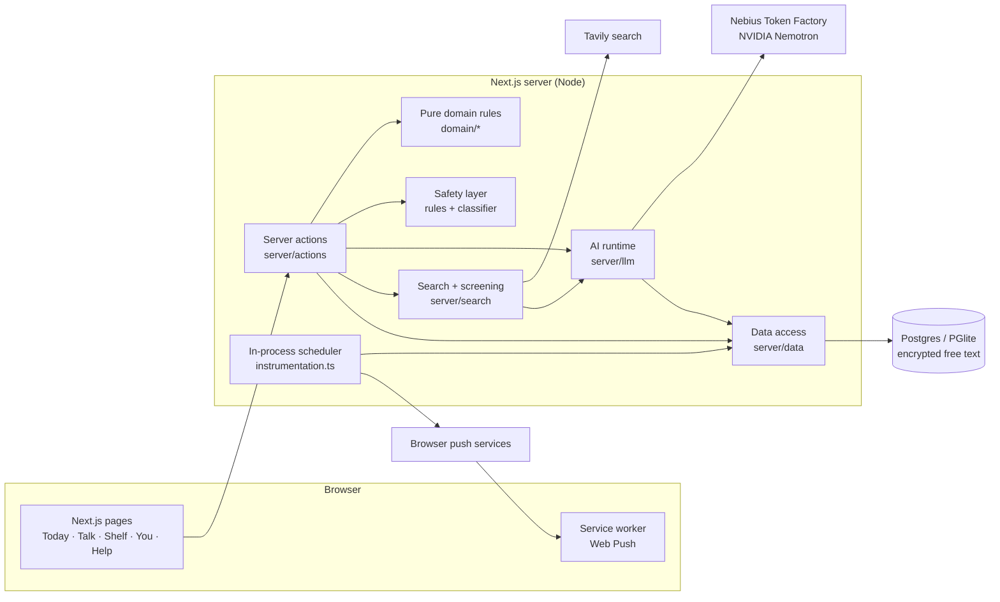

# Koe architecture

Koe is a private AI companion for adults living with depression. It learns about you in a short intake, plans a gentle day, adapts that day when your energy drops, reminds you at the right moments, finds a few trustworthy things to read, and is there to talk. It supports human care and never replaces it.

This document describes how Koe is built and where its limits are.

## 1. Principles

1. **The code decides; the model proposes and phrases.** State, scheduling, permissions, counts, safety rules and reminder firing are deterministic code. Models draft plans, write short lines, classify risk and choose tools.
2. **Every model output is validated, and there is a fallback.** Replies are checked against a zod schema, then against the plan rules, the guardrails and the safety rules. Anything that fails is replaced by a deterministic version. With `KOE_AI=off` the whole app still works.
3. **The person stays in control.** A model-made change to the plan, to memory or to reminders is a proposal until the person confirms it, or it comes with a one-tap undo when they asked for the change themselves (for example the daily check-in).
4. **A context packet, not chat history.** Each AI call gets a compact, structured description of the person: the intake model, the approved summary, approved memory cards, outcome counts for the last 7 days and today's plan. The prefix is stable, so the provider can cache it.
5. **Private by default.** Free text is encrypted at rest. The person's own words are never sent verbatim to web search; search queries are generic topics, scrubbed in code. Memory can be turned off, and the person can export or delete everything.

## 2. System overview

**Stack:** Next.js 16 (App Router, server actions), React 19, TypeScript, zod 4, Drizzle ORM. The database is PGlite (embedded Postgres) locally and Postgres when hosted. Auth is Better Auth with anonymous guests. Web Push uses VAPID. Tests are Vitest (unit and live evals) and Playwright (end-to-end, axe accessibility).

## 3. Code layout (`web/`)

| Path | What lives there |
|---|---|
| `app/` | Routes. `(app)/` holds the signed-in or guest pages: `today`, `talk`, `shelf`, `you/*`, `intake`. Public pages are `/`, `/help`, `/about`, `/privacy` and `/sign-in`. API routes cover auth and export. |
| `features/*` | Client components per feature: intake, today, talk, safety, onboarding, settings, connect, journey. |
| `components/chat/*` | Shared controlled choices, checked-message transcript, loading dots and a caller-supplied checked-stream reader. `domain/chat-turn.ts` validates the turn contract and supplies a plain-text fallback. |
| `domain/*` | Pure, unit-tested rules with no I/O: the day-plan menu and guardrails (`plan-menu.ts`), the intake model (`intake.ts`), risk patterns (`safety.ts`), reminder timing (`reminders.ts`), tone lines (`tone.ts`) and time helpers. |
| `server/actions/*` | Server actions, the only write path from the UI. Each checks the viewer, validates input, screens free text and then calls `server/data`. |
| `server/data/*` | Database reads and writes per area. Text is sealed and opened here. |
| `server/llm/*` | The AI runtime (`nebius.ts`), usage logging and budget (`usage.ts`), the context packet (`context.ts`) and one module per agent (`intake.ts`, `talk.ts`, `coach.ts`, planner). |
| `server/search/*` | Tavily, adult-resource screening, weekly cache and the Shelf refresh pipeline. |
| `server/db/*` | Schema, migrations runner, guest→account ownership transfer. |
| `drizzle/` | SQL migrations. |
| `instrumentation.ts` | Starts the minute scheduler for reminders and the hourly chat-history purge. |
| `tests/` | Unit tests, `e2e/` (Playwright) and `eval/` (live model evals). |

## 4. Data model

All user-owned tables reference `user` with `ON DELETE CASCADE`. Guest data moves to the account when a guest signs up (`server/db/ownership.ts`). `/api/export` returns everything as JSON. Columns ending in `Enc` hold AES-256-GCM sealed text (`server/crypto.ts`, format `v1.<iv>.<tag>.<ciphertext>`).

| Table | Purpose |
|---|---|
| `user`, `session`, `account`, `verification` | Better Auth. Guests are real anonymous users. |
| `profile` | Region, timezone, 18+ attestation, coaching pause, memory and chat-history switches, reminder budget and quiet hours, tone, appearance. |
| `user_model` | The sealed intake model (goals, routine, what used to help, people, support, tone, morning-plan time) and the summary the person approved. |
| `plan_day` | One row per plan version per local day: energy, mode (normal/lighter) and a sealed snapshot of the items. Used for "what changed" and undo. |
| `week`, `week_item`, `piece` | Rolling weeks and the person's approved things. Each thing's words, deadline and title are sealed in `week_item`. Approval IDs prevent duplicate saves; adding a thing preserves earlier IDs. The `piece` table is no longer written or read but stays for older rows; ownership transfer, export and cascade deletion still cover all three tables. Older rows load with retired fields ignored and a fallback title. New timestamps carry a timezone. |
| `step` | An entry in the day (internal name). Kind from the menu, time of day, sealed title and why line, size (tiny/small/medium), origin (intro/planner/you/talk), status. |
| `step_version`, `step_report` | Earlier wordings, and what happened (done/partly/not today, how it compared with expectations). |
| `check_in` | The once-a-day energy answer. |
| `memory_card` | Sentences the person added or approved, with where each came from (intro/you/talk/report). |
| `conversation`, `message` | Talk. Message text and tool proposals are sealed. A conversation can be safety-paused. |
| `person`, `reach_out` | People in your corner, and drafts the person sent themselves. |
| `note`, `weekly_review` | The person's notes and weekly look-back. |
| `reminder`, `push_subscription` | Reminders the person turned on, and browser push endpoints (allowlisted push services only). |
| `safety_event` | That a risk signal was seen, where, and what Koe showed. Never the text. |
| `agent_run` | One row per model or search call: purpose, model, tokens, latency, estimated cost, fallback used, dropped tool calls. Never the text. |
| `shelf_item`, `shelf_refresh` | Owner-scoped picks (URL, title, sealed why, Save / Not for me) and refresh attempts, including empty results and durable Talk request keys. Both transfer to accounts, export and cascade on deletion. |
| `resource_cache` | Shared weekly screened metadata per enum tag set. Public titles, links and safety flags only; no snippets, personal text or why lines. |

## 5. AI system

### Models (Nebius Token Factory, reasoning off via `chat_template_kwargs.enable_thinking=false`)

| Role | Default model | Why |
|---|---|---|
| Intake synthesis, day planning, Talk | `nvidia/Nemotron-3-Ultra-550b-a55b` | The best judgement for personal plans and conversation; fast with reasoning off. |
| Safety classifier, small rewrites, resource screening | `nvidia/NVIDIA-Nemotron-3-Nano-30B-A3B` | Cheap and quick for narrow yes/no and one-line jobs. |
| Fallback | `nvidia/nemotron-3-super-120b-a12b` | Used once when the primary fails with a network error, timeout, 5xx or 429. It shares the caller's time budget. |

Model IDs are configuration (`KOE_CHAT_MODEL`, `KOE_FAST_MODEL`, `KOE_SAFETY_MODEL`, `KOE_FALLBACK_MODEL`), not code.

### Runtime (`server/llm/nebius.ts`)
- `complete`: plain text. `completeJson`: strict `json_schema` output, downgraded to `json_object` if the provider rejects it, zod validation, and one corrective retry. `completeWithTools`: OpenAI-style tools defined with zod; invalid or unknown tool calls are dropped and counted. `streamText`: server-sent events, with the fallback only before the first token.
- Every call names a `purpose` and optionally a user. Each call writes an `agent_run` row. Each user has a daily call budget (`KOE_AI_DAILY_CALLS`). `npm run ai:usage` prints calls, tokens, cost, fallbacks and errors by purpose and model.

### Agents

| Agent | When | Output and checks |
|---|---|---|
| Intake synthesiser (`intake.ts`) | End of the four-turn chat intake | Summary, up to 4 memory proposals, 3 plan items. Checked against zod, the composition rules, the guardrails and the safety rules. Failing items are swapped for rules-based ones. AI off: `fallbackPlan`. |
| Work interview (`interview.ts`) | After intake, or from the Today continuation | Gathers up to three weekly things: one question for what, at most one follow-up (usually the deadline), at most seven Koe turns. The model returns a short title each turn; `what` and `when` must be the person's exact words. Input rules and the fail-closed classifier run before replies. Output checks cover messages, choices and titles, including AI tells (`domain/interview-text.ts`); fixed fallback turns remain available. Approval alone writes the week. No breakdown into pieces. |
| Planner (`planner.ts`) | First open of the day, check-in, "Not today" (smaller/swap), lighter day | A new plan version, plus a one-line note on what changed. Same checks. AI off: deterministic adaptation. |
| Talk | Each message | Reply text plus tool proposals: add, move or shrink an entry, set a reminder, save a memory, find resources, draft a message, prepare for an appointment. Proposals are written only when the person confirms them. |
| Resource screener | Weekly Shelf refresh, or a confirmed Talk request | Rules then Nano: exact HTTPS host, adult audience and excluded subjects. Fail-closed on model errors; validated why line or a fixed fallback. AI off uses rules and fixed copy. |
| Safety classifier | Every Talk turn | Fail-closed: if the classifier errors or times out, no normal reply is shown. |

### The day-plan menu (`domain/plan-menu.ts`)
Plans are built only from 11 kinds of entry, each with an evidence note: something you used to enjoy, a small task broken down, look after the basics, move a little, get some fresh air, reach out to someone, untangle one problem, wind down / steady wake time, be kind to yourself, a small piece of work or study then a break, and talk to someone who can help. Composition rules apply: 3–5 entries, at most one social and one movement entry, at least one entry from what used to help and one practical entry, small by default. A "never suggest" list is enforced in code: weight, calorie or diet content, light-box therapy, sleep restriction, expressive-writing prompts, supplements and medication, work decisions, diagnoses, streaks and efficacy promises. An eating-concern rule removes food and exercise entries and adds a gentle pointer to a clinician.

## 6. Safety

1. **Rules first.** `domain/safety.ts` pattern-matches risk language in every free-text field (intake answers, notes, Talk, memory cards, plan text, drafts, check-in word). A hit saves the person's words, logs a `safety_event` without the text, pauses coaching and shows a fixed "are you safe right now?" check with verified, region-specific Help contacts. The person resumes with "Carry on".
2. **Model classifier on Talk**, fail-closed.
3. **Output filters.** Model text is re-checked for risk, phone numbers, URLs and guardrail breaches. Koe never generates crisis numbers; Help numbers come only from a verified, dated list (`fixtures/help-resources.ts`).
4. **No tools on risky turns.**
5. Help is public, needs no sign-in, and is one tap from every screen.

The risk patterns and the crisis-flow wording are engineering defaults and have not had clinical review. Clinician review is a release gate.

## 7. Privacy

- Free text is sealed at rest. Logs and `agent_run` never contain text.
- **Web search never receives the person's raw words or names.** Queries are either built from fixed phrases keyed by enum tags or abstracted by Nebius into generic 2–10 word topic queries and scrubbed by `sanitizeSearchQuery` (rejecting names, contact details, verbatim multi-word user phrases, and unsafe topics). In Talk, the proposal card shows the exact query before it runs.
- The Shelf stores the title, URL and Koe's own one-line summary, and links out. It never copies pages.
- With memory off, nothing from the person's records goes to the model. With chat history off, conversations are purged hourly.
- Export everything (`/api/export`) and delete everything (cascade) are in You → Your data.

**Interview proposals.** Multi-choice replies preserve every selected label and Other text in an owner-scoped browser draft. The combined reply is capped at 400 characters without truncation. On approval the person may rename or remove things; the server keeps the signed `what` and `when` and checks each title with the same text rules. Free text remains encrypted, and no extra personal text is stored for these checks.

**Talk tools (`domain/talk-tools.ts`).** Talk calls `completeWithTools` with eight tools (add, move, shrink, reminder, memory, find resources, draft, appointment). A call is only ever a proposal: it is checked (schema, words, rules, at most two cards, none on a risky turn) and stored with the reply as a card. Confirm runs the existing action (`server/plan-edit.ts`, `planToday`, `remindMe`, `turnOnMorningPlan`, `addMemory`) once; No thanks writes nothing. `find_resources` runs the same Shelf pipeline and reports the real count. `requestedSearches` recovers older or interrupted confirmed searches. Queries come only from `buildResourceQuery` (runtime-validated enum tags).

**Shelf and Appointment lookup.** Pages read stored picks without awaiting search; a client action refreshes when needed, and an explicit `Refresh picks` button rebuilds current picks from the latest user data (capped at three manual refreshes per UTC day with a calm notice when reached). With memory on, Nebius plans privacy-safe search intents from the person's weekly things, today's plan, memories, notes, intake and Talk takeaways, mapped to deterministic why-line templates (`For "…"`, `Because you noted "…"`, `Because you chose "…"`). Results are screened by deterministic domain, path, quality and safety rules plus Nano adult-audience and substance verification; videos require oEmbed channel verification. Results are revalidated per person, including local eating constraints with memory off. Save / Not for me has owner-bound Undo. Search off or coaching paused leaves saved picks readable. Appointment (`/you/care`, under `More`) reuses the same candidate collector, `sanitizeSearchQuery` privacy scrubber, and Tavily pipeline so one tap on `Look up` (plus optional safety-screened extra instructions) finds bookable regional services and professionals with a clear fit reason and `Go to link`. People (`/you/people`) is parked behind a coming-soon illustration with its underlying tables and actions preserved.

**You.** What Koe knows exposes the saved summary, intake answers and memory cards even when memory is off. Information changes require an explicit save, are sealed and owner-scoped, and reject stale model versions. They do not call a provider or change the current day, people or active reminders. The eating-concern flag is derived locally and retained; it is not accepted from the browser. Saved intro tone and morning-plan preferences are separate from the active controls in Appearance and Reminders.

**Entry paths and drafts.** Legacy `/steps/[id]` links lead to the current entry on Today, including its scroll position, or read-only Look back history. Add and problem-solving forms live under `/today`; People uses the same versioned add action. Weekly choices save intentions only; Today handles plan changes and Undo. Tab-local form drafts are validated and scoped to their owner. A stale information draft needs an explicit choice before it replaces current answers in the editor. A confirmed anonymous-to-account link moves browser drafts using server-confirmed owner IDs; no credential values enter that handoff. A collision retains both drafts under the account's cleanup scope, without automatically loading the extra draft. Successful account deletion also clears the person's browser drafts; failed deletion keeps them. Search-budget reservations write an explicit UTC instant, independently of the database's local timezone.

**Chat intake and interview.** Four turns collect priorities, day/wake context, lifts and an optional weekly thing. That last answer seeds the work interview without asking it twice. People/support/busy-time questions are absent; tone defaults to calm. Main navigation stays hidden during onboarding, while Help remains available. Intake and interview drafts are validated and scoped to their owner; unscoped legacy drafts are ignored. Day and wake notes share the existing 200-character storage limit. Morning reminders remain off until explicitly enabled. Skipping the interview or turning memory off uses a local reveal.

The interview continuation is an authenticated encrypted browser token, expiring after seven days. No unconfirmed interview transcript is written to a database. In-process sequence checks reject stale turns during the current server lifetime; after a restart the signed token can resume. Durable approval IDs keep week saves idempotent across restarts. Edits are re-screened, owner-checked and checked against local eating protections at approval. Renaming preserves the original source phrase as encrypted provenance. The first intro and week share one database transaction. Returning people can add a thing through `/intake#interview` without rewriting their intro or day. Client navigation follows successful draft cleanup, including after server revalidation.

## 8. Reminders

Web Push with VAPID. The person turns a reminder on for a timed entry, or for the morning plan (the one Koe reminder per day, within the daily nudge budget). Permission is requested only at that moment. A minute scheduler in `instrumentation.ts` sends due reminders. It respects quiet hours and the daily nudge budget, skips reminders that are overdue rather than sending them late, and pauses a reminder after 3 are ignored. Lock-screen text is neutral. Push endpoints are restricted to the browsers' push services. "Send a test now" reports a plain result and is rate-limited. Calendar export is retired. Reminders follow plan changes: moving an entry moves its reminder; a swapped-out entry's reminder is parked and comes back on undo.

## 9. Operations

| Variable | Effect |
|---|---|
| `KOE_AI=off` | No model calls. Rules-based plans and templates are used everywhere. |
| `KOE_SEARCH=off` | No web search. The Shelf shows saved items only. |
| `KOE_AI_DAILY_CALLS` | Per-user daily model-call budget (default 200). |
| `KOE_SCHEDULER=off` | Stops the in-process scheduler (tests, or a separate worker). |
| `KOE_AI_STUB=on` | **Tests only.** Talk answers from a script (`server/llm/talk-stub.ts`) instead of the model. Refused unless `APP_URL` is `127.0.0.1` or `localhost`, so a hosted app ignores it. Set only in `playwright.config.ts`. |
| `KOE_SEARCH_STUB=on` | **Tests only.** Fixed Shelf search results; accepted only for an exact local HTTP `APP_URL`. Hosted URLs cannot activate it. |
| `NEBIUS_API_KEY`, `TAVILY_API_KEY`, `DATA_ENCRYPTION_KEY`, `AUTH_SECRET`, `VAPID_*`, `DATABASE_URL`, `APP_URL` | See `.env.example`. |

**Single-instance assumption:** the scheduler and the rate limits live in memory. Several instances would need a shared job runner and a shared rate-limit store.

## 10. Quality gates

- `npm run check`: format, lint, typecheck, unit tests and build.
- `npm run test:e2e`: Playwright on desktop and 390 px mobile with the AI off. It covers axe (WCAG 2.2 AA) on every page and no horizontal scroll at 320/390 px.
- `npm run eval:safety`: a live Talk suite (risk phrasings, no phone numbers, no medication advice, discloses it is an AI, short replies, no "we/us").
- `npm run eval:plan`: a live planning suite (valid schema, composition, guardrails, personalisation, eating-concern handling).
- `npm run eval:interview`: synthetic interview personas run live, with deterministic checks only: schema, turn and follow-up limits, a checked title on every thing, no AI tells or stock phrases, no food or exercise words for the eating-concern persona, and a safety stop on risk words. Transcripts go to ignored `.data/v3-a2-interview-transcripts.json` for direct review.

## 11. Known limits

- Not a medical device, and no clinical validation. The safety defaults need clinician review before real users.
- One server instance. In-memory rate limits.
- Shelf results are screened by code rules and a small-model check, not reviewed by a person. YouTube videos are kept only from a short list of verified channels.
- Calendar is one-way (`.ics`). Two-way calendar sync is on the roadmap.
